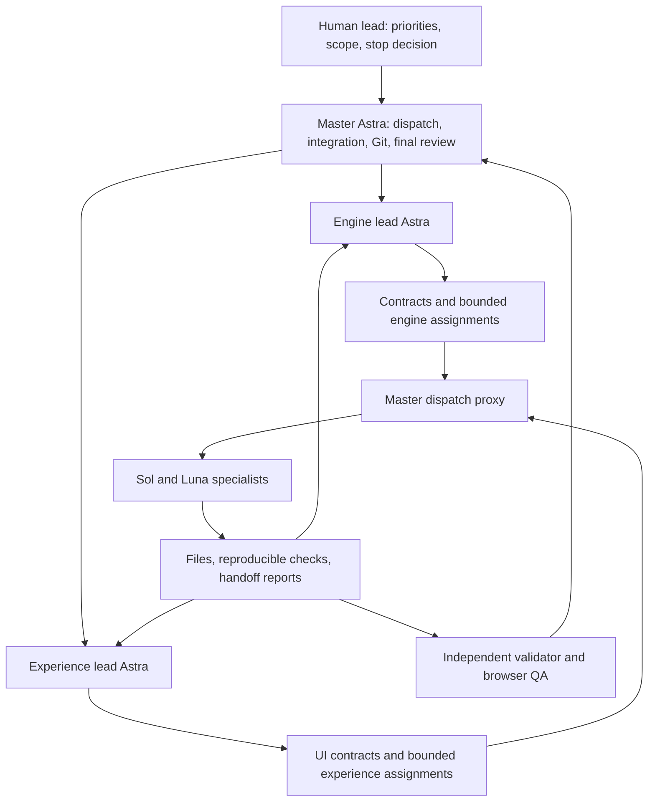

# Research methodology and agent-swarm retrospective

This document records how the Plotline prototype and its research evidence were produced. It describes the observed run, including tool limitations, unsuccessful ideas and review failures. It is a reusable operating method, not a claim that adding agents always makes development faster or more reliable.

## Scope and timeline

The user authorized an autonomous four-hour research/build lab on 13 October 2026, initially scheduled for **01:52:58–05:52:58 UTC**. The scope included local implementation, original UI/UX design, public dataset acquisition, experiments, tooling and delegated work inside `hack_roll`. This superseded an earlier planning-only / Claude-only design restriction.

At approximately **04:19 UTC**, the user requested an early checkpoint to preserve usage, then requested an extensive handover. Feature expansion stopped; workers produced safe handoffs and were closed. The final local checkpoint was committed at approximately **04:28 UTC**, after about **2 hours 35 minutes**. A later user instruction explicitly authorized committing and pushing the tracked project, documentation and this methodology to the existing GitHub repository.

| Milestone | Durable record |
| --- | --- |
| Save supplied data, image/context and planning | Commits `0a2de93`, `b524a37`; source audit and planning documents |
| Establish scope, roles and boundaries | `e26dad3`; [charter](charter.md) |
| First verified working prototype | `7cecd05`; engine/app implementation and retained proof bundle |
| Retain adaptive study and live-query direction | `20cd47c`; selector research and [live brief](live-lab-brief.md) |
| Stable live/JRC/research handover | `c0e46b6`; [complete handover](../HANDOVER.md) and [final checks](final-verification.json) |
| Publish for future reference | Follow-up documentation commit and push on `guru/plotline-research-lab` |

The operational narrative is in [master-log.md](master-log.md). Some early entries describe pending work at their timestamp; later reviews and the final handover take precedence for the checkpoint state.

## Actual organization

The master was **GPT-6-Astra at high reasoning effort**. Two leads inherited Astra at **medium** effort. Sol workers used the explicitly requested `gpt-6.1-sol` override; Luna handled public data acquisition and historical-vintage research.

The intended hierarchy was master → two leads → specialist workers. The actual runtime did **not** expose nested spawning/messaging to the leads. The master therefore acted as a dispatch proxy: leads wrote scoped assignments and reviewed shared reports; the master launched, resumed and closed their workers and relayed findings. No hidden nested runtime was used.

The runtime admitted **seven concurrent subagents**, including the two leads. Thus, while both leads were open, only five additional workers could run concurrently. Completed workers were closed and resumed for new bounded assignments. The 14 distinct subagent sessions below were not simultaneous.

| Agent | Model / effort | Main responsibilities across the run |
| --- | --- | --- |
| Volta | Astra / medium | Engine contracts, integration, scientific decisions and minimal bundles |
| Hooke | Astra / medium | App integration, product design, accessibility, launcher and experience acceptance |
| Euler | Sol / medium | Current product interaction research and design critique |
| Boole | Sol / medium | Visual primitives, local notes and readable receipts |
| Parfit | Sol / high | Browser journeys, mobile/keyboard checks and race/failure tests |
| Ramanujan | Sol / high | Codec candidates; separate JRC engine and proof/export fixes |
| Bohr | Sol / high | Independent scalar oracle, boundary regressions and live query backend |
| Galileo | Sol / high | Benchmark registry; strong Hansen and standard JRC controls; proof hardening |
| Feynman | Sol / xhigh | Independent cross-layer, JRC and strong/spatial validation |
| Carver | Sol / high | Runtime data gates, cohort index and live response binding |
| Chandrasekhar | Luna / high | Official JRC acquisition and preregistered Hansen vintage comparison |
| Lovelace | Sol / xhigh | Source-only adaptive codec selection with spatial holdout |
| Godel | Sol / xhigh | Spatial-rule sensitivity and witnesses; later RuleLens inspection, deferred before code |
| Ptolemy | Sol / high | Separate JRC frontend gate and native-grid panel |

The user requested faster throughput and fast mode for non-Astra workers. The spawning API exposed model and reasoning-effort selection, **not a speed/service-tier control**. No fast-mode change or measured 20% throughput increase is claimed. The goal tool reported **5,822,198 aggregate tokens** and 9,303 elapsed seconds at completion. This is the tool's recorded counter, not a remaining quota, billing statement, unique generated-token count or evidence of efficiency. There was no controlled single-agent comparison.

## Delegation contract

Every implementation task named a concrete output and an exclusive write set. For example, the live backend worker owned `engine/live_*.py`, focused tests and its report; the client worker owned `app/src/live-client.ts` and its checks; the experience lead owned navigation, configuration and integration. Independent validators wrote only validation scripts and reports.

A good assignment included:

1. The question to answer or user-visible behavior to deliver.
2. Existing files and contracts to read, including the actual source contents.
3. Exclusive write paths and explicit read-only boundaries.
4. Required positive cases and counterexamples.
5. Exact deliverables: code, commands, results, limitations and changed-file list.
6. A bounded time/compute/download budget and stop condition.
7. A handoff recipient and an adoption gate.

Workers did not stage, commit, change branches, push, publish, add dependencies without ownership, or modify immutable source inputs. The master owned Git checkpoints. Runtime constraints were disclosed rather than bypassed. Lead-owned assignments are retained in [engine tasks](engine-worker-tasks.md), [experience tasks](experience-worker-tasks.md), and the later topic-specific task files.

This separation reduced conflicting edits, but did not eliminate coordination cost. The live client discovered that the backend contract needed canonical result/evidence strings to verify hashes across Python and JavaScript. That finding became an additive contract change, followed by actual-service acceptance. A passing fixture test was not treated as proof that the live response already worked.

## Research loop and promotion rules

The operating loop was:

**Question → frozen inputs and method → bounded implementation/experiment → independent counterexamples → measured decision → explicit integration.**

An idea could move through these states:

| State | What it means |
| --- | --- |
| Proposed | A hypothesis or design direction; no result implied |
| Candidate | Runnable code or measured artifact, still under review |
| Worker-verified | Author's positive and negative checks pass |
| Independently reviewed | A lead or separate validator reproduces relevant evidence and challenges failure modes |
| Accepted for a stated scope | Specific artifact or feature may be integrated with its limitations |
| Deferred or rejected | Saved reasoning and evidence; no success badge or silent production adoption |

These states were scoped. Source pixels could be independently correct while a measurement verifier still accepted a forged proof. A JRC source view could be accepted without adopting its research standard-format codec. A scientific storage result could remain useful while its verifier needed hardening. No single “all green” label replaced those distinctions.

This was an iterative research and engineering process. It did **not** modify the agents' underlying model weights, prove recursive model self-improvement, or train an environmental classifier. The actual ML experiment was a bounded codec-selection policy over public raster patches.

## Data and scientific controls

### Preserve inputs before interpreting them

The supplied CSV/GeoJSON pair was saved, hashed and joined before design or modeling. The audit established 17 one-to-one records and corrected the proposed location/tile mismatch. Supplier declarations were retained as declarations, not used as independent environmental labels.

Current Hansen bands were pinned with native grid, masks, class definitions, release identity and acquisition provenance. JRC remained a separate native-grid product. Raw acquisition caches were distinguished from the small chips required to reproduce the product.

### Freeze the computational question

The accepted screening query selected original native cell centers covered by the exact polygon. It preserved masks, outside support and tri-state results. An absent event with incomplete support stayed unknown. Counts remained cells, never inferred hectares or legal classifications.

Changes to spatial rules were evaluated as separate research, not silently folded into the accepted query. The research compared center inclusion with strictly positive footprint intersection and distinguished that intentional change from a one-ULP implementation error caused by shifted floating-point arithmetic.

### Require full fidelity and useful counterexamples

Plot-level equality alone was insufficient. Validators changed off-plot values and masks while leaving all 17 plot answers unchanged; those changes still had to invalidate full-pixel fidelity claims. Tests also distinguished boolean `true` from integer `1`, null from zero, valid class 0 from unknown, and witnessed positives from incomplete-support absences.

The independent scalar oracle used different membership/reduction logic, with shared geometry/topology dependencies disclosed. The spatial study added exact rational clipping on bounded analytic fixtures. These are complementary checks, not claims of wholly independent software stacks.

### Measure the complete representation

Storage included required payloads, metadata, indexes and masks. Original and encoded data covered identical support. Common-input views added the same supplier/provenance inputs to both sides. Raw whole-tile download size was never used as a misleading crop-compression denominator.

Measurements separated encoding/setup, hot preloaded queries, fresh-process load plus query, and indexed access. CPU, peak RSS and raw timing samples were retained. OS cache was uncontrolled; “process-cold” never meant “disk-cold.” Timed samples were checked for correct answers and bound to source/code/store identities.

### Prevent adaptive research from grading itself

The codec selector used source-only patches with separated spatial training, validation and sealed holdout regions. Policy selection happened before holdout evaluation; feature computation and package overhead counted. Supplier statuses were not labels. A learned policy losing to a fixed compressor was a valid result and blocked production integration.

The vintage study preregistered **one** historical release—Hansen 2023 v1.11—before reading values. It used all three historical bands and their own masks, compared only the shared 2021–2023 interval, and omitted unsupported future outputs. It did not search multiple releases until one matched the declarations.

## What the experiments changed

| Investigation | Observed result | Decision |
| --- | --- | --- |
| Basic packing/chunking | Some candidates were larger than compressed source inputs | Retain losing candidates; improve the comparison rather than claim an automatic win |
| Stronger standard Hansen control | 532,444 B vs 535,012 B custom, with different load/index/resource tradeoffs | Show the standard control; no universal custom-format claim |
| Adaptive selector | Final joint policy lost to fixed custom and optimized standard controls | Reject production ML integration |
| Indexed custom reads | Slower than source under the implemented cache/integrity behavior | Keep full preload for the small demo; disclose the actual reader policies |
| Spatial-rule sensitivity | Five period flags changed; 15 witnesses independently reproduced | Keep as explanatory research; production rule unchanged |
| Historical vintage | No shared-period count or flag changes on the 17 plots | Preserve the negative result; company source/rule meaning remains unresolved |
| Live local query workflow | Actual HTTP/browser checks passed with complete, bound evidence | Integrate the bounded read-only service and UI |
| JRC companion | Full native preservation and independent query/export checks passed | Integrate a separate native baseline view, with no grid fusion/legal verdict |

Exact settings, measured runs and uncertainty are in the [results index](results-index.md), [engine report](engine-report.md) and linked topic reports. Cross-study timing columns must not be combined into an invented benchmark.

## Independent review and correction examples

The independent validation track found concrete errors rather than only running author-written tests:

- A plot-only comparison could miss off-plot raw/mask corruption.
- Rehashed receipts and benchmark payloads could remain internally contradictory.
- Unknown values could be rendered as zero or “no event.”
- A redundant source file inflated the baseline denominator.
- A timing runner checked the last answer but missed a wrong intermediate sample.
- Ordinary JRC export unnecessarily remeasured and required the large full-tile cache.
- Python equality accepted numeric `1` where a proof required boolean `true`.
- A late response could have been shown for a different temporary geometry without explicit request/draft binding.

Fix acceptance used paired positives and negatives: a correct artifact must pass, and a targeted self-consistent forgery must fail. At wrap-up, the master reran the unchanged independent strong-control script against the revised artifact: the fresh positive passed and all six original forgeries rejected. This was a master replay of an independent reproducer, not a claim that its original author personally reran the revision.

Reviewers can also be wrong. The lead initially alleged a missing `engine/export.py` dependency in the strong-control proof binding; the validator identified that the active helper came from an already-bound module. The allegation was retracted and recorded. Review status is evidence-based, not authority-based.

## UI/UX methodology

The experience track researched official product interactions, then adapted them to the actual evidence task: inspect a number's basis, retain context across views, separate declarations from observations, make differences local, and provide useful keyboard paths. [Product research](product-research.md) records sources, dates and limitations; no claim is made that those products were cloned or their private internals inspected.

The UI used real computed artifacts. Empty, unavailable, unknown, stale, rejected and zero-observation states remained distinct. Frozen-review navigation was not described as a fresh backend computation. The live lab later added explicit temporary geometry, Run/Cancel, request guards and complete evidence.

Browser testing used T3 preview first. Documented resize/host failures justified isolated project-local Playwright where needed. The passing live suite consumed actual unaugmented service responses; browser-only injected delays/failures tested recovery and stale-response handling without stopping shared services or fabricating successful answers.

## Reproducibility and handoff

Durable artifacts include source provenance, versioned interfaces, immutable experiment/run records, code identities, raw measurements, negative controls, screenshots, runnable commands and exact bundle manifests. The final command record shows **198 engine tests, 298 frontend checks, a production build, Hansen/JRC verification and the six strong-control negatives passing**. Historical and overlapping runs are not added together as a fabricated unique-test total.

Normal product execution and retained proof reproduction do not require full acquisition tiles. Rechecking original-download windows or some historical studies does require those caches. The vintage acquisition script's cache-restoration limitation is explicitly documented. Package inventories overlap and must not be summed as a storage metric.

The detailed restart instructions and deferred work are in [HANDOVER.md](../HANDOVER.md). The final assessment is a [mock judge review](final-judge-review.md), not an official organizer score. Its confidence depends on the evidence packet; no user study, company-approved legal contract, global workload evaluation or external environmental ground truth was established.

## Reusing this method

For another project, start with one complete slice and an explicit output contract. Give each worker a disjoint responsibility and a falsifiable acceptance condition. Add an independent validator early, keep research outputs separate from accepted artifacts, and retain negative findings. Keep publication, dependency and Git ownership clear.

Increase parallelism only when there are genuinely independent questions. Reuse knowledgeable workers for bounded follow-ups, close completed sessions, and distinguish orchestration limits from model limitations. Do not optimize for token consumption as a proxy for useful work. Track elapsed time, completed evidence, rework and unresolved risks; cost/throughput comparisons require a proper baseline.

When the human changes the budget or requests a stop, finish a safe checkpoint, stop new dispatches, record unfinished work honestly and close workers. Do not automatically resume an unused time allocation later.

## Session identifiers for traceability

| Agent | Session identifier |
| --- | --- |
| Master | `01a130e9-aaf5-7a53-9cff-96d579f69b35` |
| Volta | `01a132f8-f774-7b32-9eef-2c0f572c1df0` |
| Hooke | `01a132f8-f7e5-7fd0-9690-31faa43db819` |
| Euler | `01a132fc-4376-7633-8e45-e211159f29a4` |
| Boole | `01a132fc-4451-72e2-b7c4-b941f1bf760d` |
| Parfit | `01a132fc-44a6-7dd2-a88b-4d27fce9efb5` |
| Ramanujan | `01a132fd-ac26-75d2-9abb-3196038cea62` |
| Bohr | `01a132fd-ac79-7c61-9e4d-d7921ec99665` |
| Galileo | `01a132fe-e706-7f53-a398-67b42b904884` |
| Feynman | `01a1330c-3349-7990-b622-f6cc5d62d0ae` |
| Carver | `01a13312-ae98-7ba3-a198-990c9a0191cb` |
| Chandrasekhar | `01a13317-a7ac-7b32-a012-ec9d1a3b2c6a` |
| Lovelace | `01a1331f-024a-7ec3-8ae1-f8ee5423680f` |
| Godel | `01a13360-b491-7c80-808f-9f87d9e87a7c` |
| Ptolemy | `01a1336f-a508-7fc0-a709-5323c6f3e815` |
